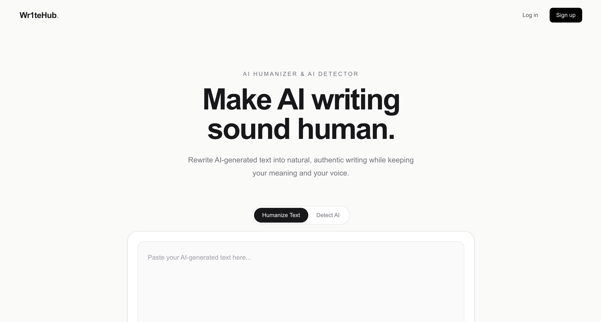
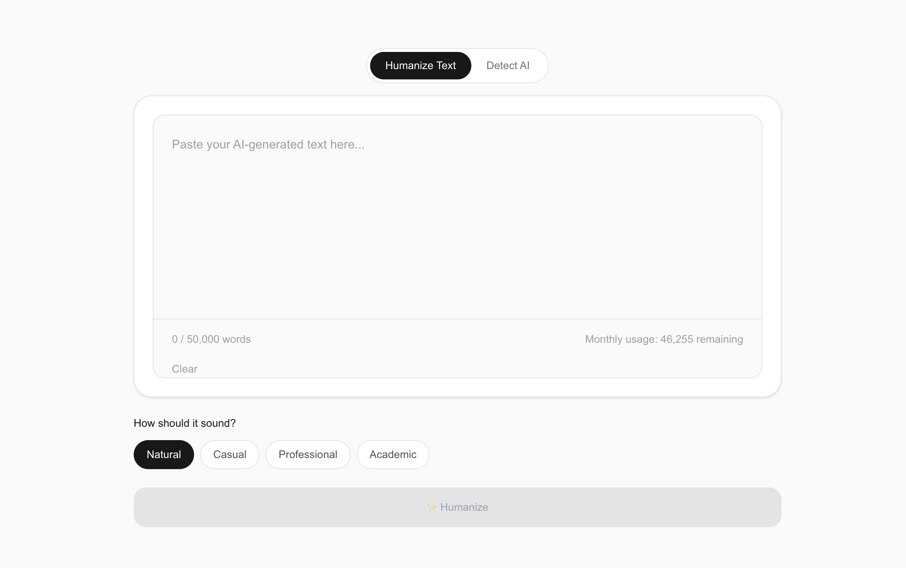
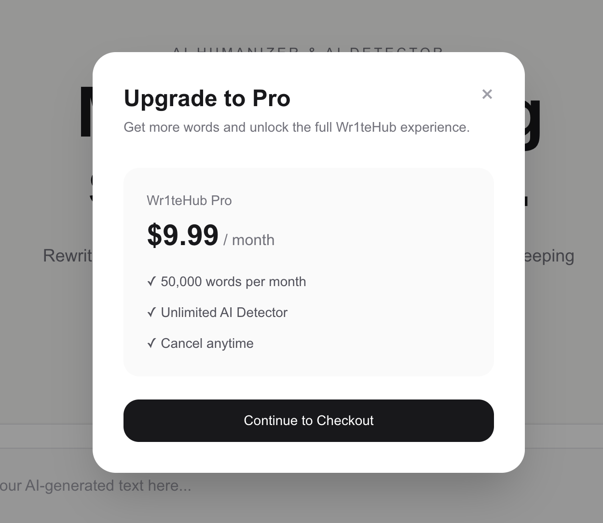
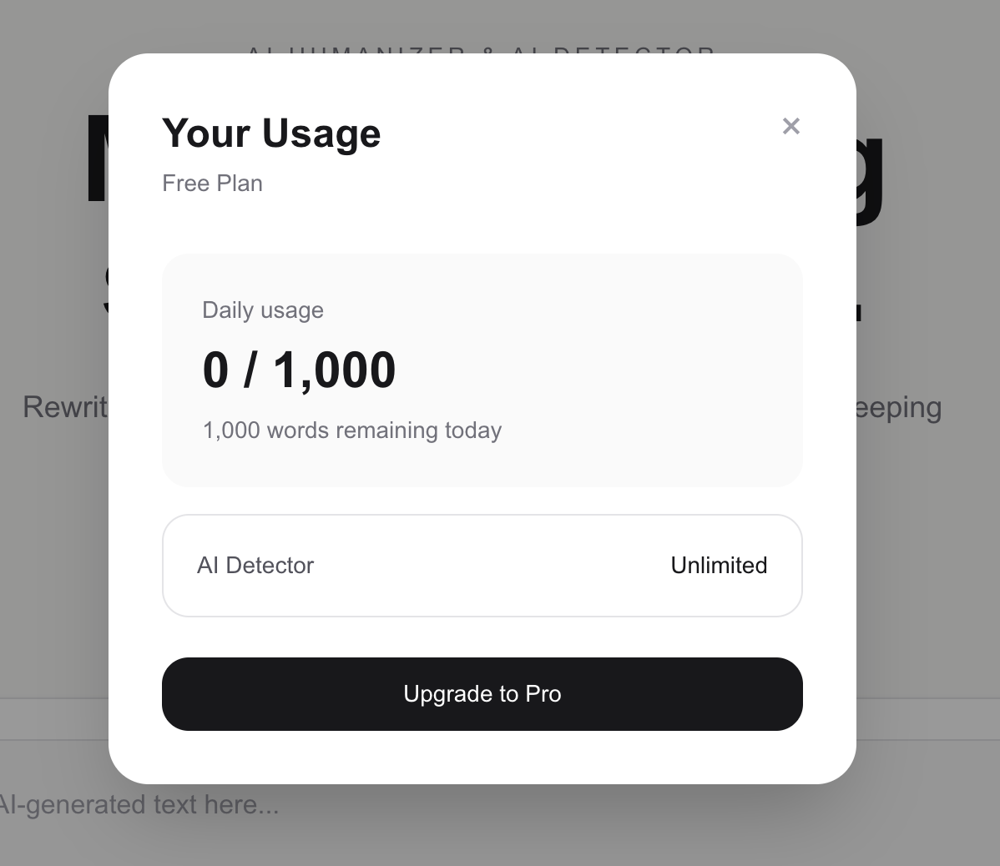

# Wr1teHub

AI-powered writing platform designed to help users improve, analyze, and refine their writing.

Live Website: https://www.wr1tehub.com/

Wr1teHub is a full-stack web application that combines AI-powered writing tools with user accounts, usage tracking, and subscription management. I designed and developed the platform from the ground up, working across product development, frontend and backend engineering, and payment integration.



## Overview

Wr1teHub provides an interface for users to work with AI-powered writing tools while managing their usage through a subscription-based platform.

The project gave me hands-on experience building and launching a product, connecting multiple services, and developing features across the full user journey.

## Features

- AI-powered writing tools
- Text analysis and AI detection features
- User authentication and account management
- Usage tracking and monthly word limits
- Free and Pro subscription plans
- Stripe Checkout integration
- Subscription management and cancellation
- Password recovery
- Responsive web interface

## Product Screenshots

### Writing Tool



### Subscription Plans



### Monthly Word Usage



## Tech Stack

### Frontend

- Next.js
- React
- TypeScript
- Tailwind CSS

### Backend and Data

- Next.js server-side functionality
- Supabase
- Database-backed user and usage management

### AI Integration

- OpenAI API

### Payments and Subscriptions

- Stripe Checkout
- Stripe subscription and webhook integration

### Development and Deployment

- Git
- GitHub
- Vercel

## Key Contributions

### Product Development

- Built and launched an AI-powered writing platform from concept to deployment.
- Developed features around writing workflows, account management, and subscription-based access.
- Connected frontend experiences with backend services and external APIs.

### Full-Stack Development

- Implemented application features using Next.js and TypeScript.
- Integrated Supabase for backend and data-management functionality.
- Connected the OpenAI API to power AI-related features.

### Payments and Monetization

- Integrated Stripe Checkout for subscription purchases.
- Implemented subscription-related functionality, including webhook processing and subscription management.
- Developed usage tracking to support monthly word limits and plan-based access.

### User Experience

- Organized the application around key writing workflows.
- Built account and subscription experiences to support users throughout the product lifecycle.
- Deployed the application publicly so users can access it online.

## Architecture

At a high level, Wr1teHub connects the user interface, application logic, database, AI services, and payment infrastructure.

- Next.js and TypeScript power the application.
- Supabase supports backend and data-management functionality.
- The OpenAI API powers AI-related features.
- Stripe supports checkout and subscription workflows.
- Vercel hosts the deployed application.

## Getting Started

To run the project locally:

1. Clone the repository.
2. Install dependencies.
3. Configure the required environment variables.
4. Start the development server.

```bash
npm install
npm run dev
```

Open `http://localhost:3000` in your browser.

## Environment Variables

Configure the required environment variables locally before running the application.

Use the variable names referenced in the project code and provide your own credentials
